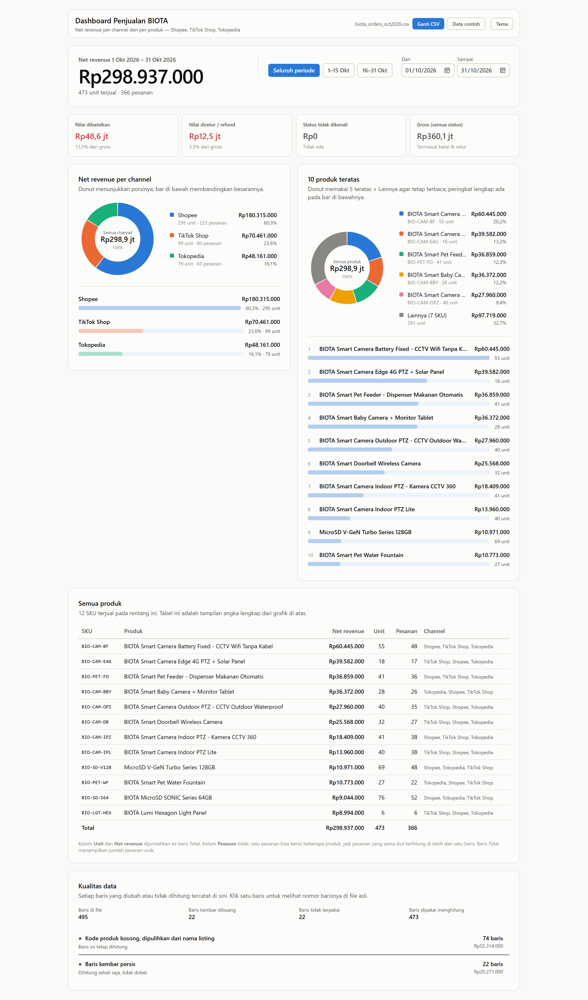
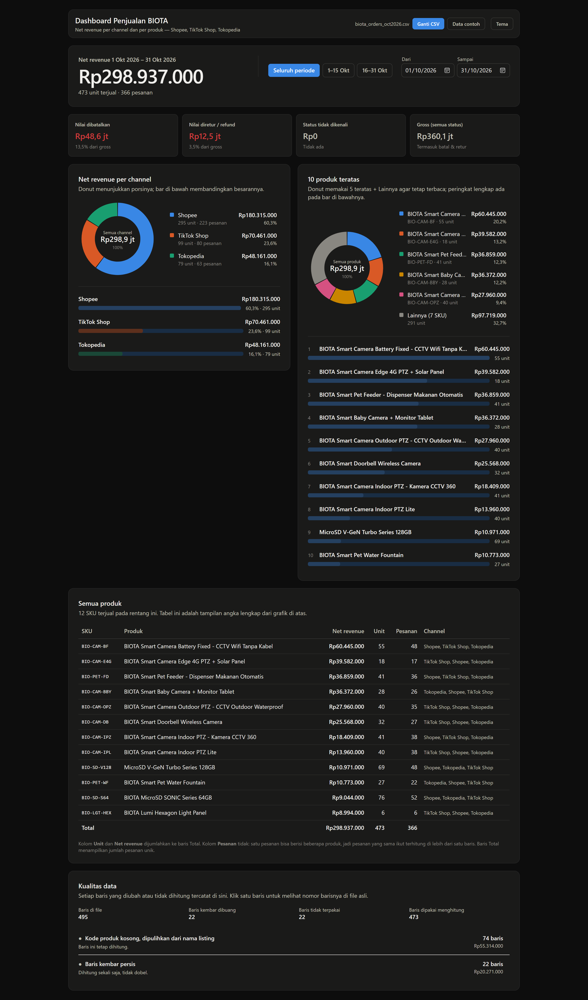

# Dashboard Penjualan BIOTA

Mengubah ekspor pesanan bulanan dari Shopee, TikTok Shop dan Tokopedia menjadi
angka net revenue yang bisa dipakai mengambil keputusan.

Upload satu file CSV, dashboard menampilkan net revenue per channel, net revenue
per produk, 10 produk teratas, dan bisa difilter per rentang tanggal.



---

## Angka akhir

Dihasilkan dari `biota_orders_oct2026.csv` (495 baris, Oktober 2026) dengan
perintah `pnpm verify`. Angka di bawah **bukan ketikan tangan dari layar** —
semuanya keluaran perintah itu.

### Total net revenue — 1–31 Oktober 2026

| | |
|---|---|
| **Net revenue** | **Rp298.937.000** |
| Unit terjual | 473 |
| Pesanan | 366 |
| Gross (termasuk batal & retur) | Rp360.098.000 |
| Tidak dihitung — dibatalkan | Rp48.620.000 |
| Tidak dihitung — diretur / refund | Rp12.541.000 |

### Net revenue per channel — 1–31 Oktober 2026

| Channel | Net revenue | Porsi | Unit | Pesanan |
|---|---:|---:|---:|---:|
| Shopee | Rp180.315.000 | 60,3% | 295 | 223 |
| TikTok Shop | Rp70.461.000 | 23,6% | 99 | 80 |
| Tokopedia | Rp48.161.000 | 16,1% | 79 | 63 |
| **Total** | **Rp298.937.000** | 100% | **473** | **366** |

### Net revenue 1–15 Oktober 2026

| | |
|---|---|
| **Net revenue** | **Rp146.226.000** |
| Unit terjual | 234 |
| Pesanan | 187 |

| Channel | Net revenue | Porsi |
|---|---:|---:|
| Shopee | Rp83.050.000 | 56,8% |
| TikTok Shop | Rp36.812.000 | 25,2% |
| Tokopedia | Rp26.364.000 | 18,0% |

### 10 produk teratas — 1–31 Oktober 2026

| # | SKU | Produk | Net revenue | Unit |
|---:|---|---|---:|---:|
| 1 | BIO-CAM-BF | BIOTA Smart Camera Battery Fixed | Rp60.445.000 | 55 |
| 2 | BIO-CAM-E4G | BIOTA Smart Camera Edge 4G PTZ + Solar Panel | Rp39.582.000 | 18 |
| 3 | BIO-PET-FD | BIOTA Smart Pet Feeder | Rp36.859.000 | 41 |
| 4 | BIO-CAM-BBY | BIOTA Smart Baby Camera + Monitor Tablet | Rp36.372.000 | 28 |
| 5 | BIO-CAM-OPZ | BIOTA Smart Camera Outdoor PTZ | Rp27.960.000 | 40 |
| 6 | BIO-CAM-DB | BIOTA Smart Doorbell Wireless Camera | Rp25.568.000 | 32 |
| 7 | BIO-CAM-IPZ | BIOTA Smart Camera Indoor PTZ | Rp18.409.000 | 41 |
| 8 | BIO-CAM-IPL | BIOTA Smart Camera Indoor PTZ Lite | Rp13.960.000 | 40 |
| 9 | BIO-SD-V128 | MicroSD V-GeN Turbo Series 128GB | Rp10.971.000 | 69 |
| 10 | BIO-PET-WF | BIOTA Smart Pet Water Fountain | Rp10.773.000 | 27 |

**Pemeriksaan silang yang ikut dijalankan otomatis:**

- Net revenue 1–15 Okt + 16–31 Okt = total sebulan ✓
- Jumlah net revenue seluruh channel = total ✓
- Jumlah net revenue seluruh produk = total ✓

Selain itu, seluruh angka di atas dihitung ulang dengan **skrip Python terpisah
yang ditulis dari nol** (bukan terjemahan dari kode TypeScript-nya), dan hasilnya
sama persis sampai rupiah terakhir.

---

## Cara menjalankan

Butuh Node.js 20 atau lebih baru.

```bash
pnpm install
```

```bash
pnpm dev
```

Buka `http://localhost:3000`, lalu upload file CSV. Kalau tidak punya file
aslinya, klik **"Pakai data contoh"**.

### Mengecek angka dari terminal

```bash
pnpm verify data/biota_orders_oct2026.csv
```

Perintah ini membaca CSV lewat kode yang **persis sama** dengan yang dipakai
dashboard, lalu mencetak seluruh angka di atas beserta pemeriksaan silangnya.
Gunanya supaya angka di README bisa dibuktikan, bukan dipercaya begitu saja.

### Menjalankan test

```bash
pnpm test
```

69 test. Isinya pembacaan format rupiah dan tanggal, klasifikasi status,
pemulihan SKU kosong, pembuangan baris kembar, batas rentang tanggal, dan
sebelas test regresi untuk bug yang pernah ditemukan (lihat *Audit lanjutan*).

### Deploy

Aplikasi ini **sepenuhnya berjalan di browser** — CSV tidak pernah dikirim ke
server mana pun. Jadi bisa di-deploy sebagai situs statis:

```bash
pnpm build
```

Di Vercel: import repository ini, biarkan semua setelan default, selesai.

---

## Data perusahaan tidak ada di repository ini

File `biota_orders_oct2026.csv` **sengaja tidak di-commit**. Brief meminta data
tidak disebarkan, sedangkan repository ini publik. Lihat `data/README.md` untuk
cara mereproduksi angkanya.

Data contoh di `public/sample/` isinya fiktif, dibuat oleh
`scripts/generate-sample-csv.mjs`.

---

## Definisi dan asumsi

### Net revenue

Brief menyebut: *pendapatan dari pesanan yang tidak dibatalkan dan tidak diretur;
pesanan yang sudah selesai maupun yang masih dalam pengiriman tetap dihitung.*

Status di file ditulis berbeda-beda per marketplace. Pemetaan yang dipakai:

| Status di file | Diperlakukan sebagai | Dihitung? |
|---|---|---|
| `Selesai`, `Completed`, `Pesanan Selesai` | Selesai | **Ya** |
| `Dikirim`, `Sedang Dikirim`, `In transit` | Dalam pengiriman | **Ya** |
| `Batal`, `Cancelled`, `Dibatalkan` | Dibatalkan | Tidak |
| `Pengembalian Dana`, `Refunded`, `Dikomplain - Retur` | Diretur | Tidak |

Net revenue dihitung dari `qty × unit_price` per baris, lalu dijumlahkan.

### Keputusan yang diambil terhadap data

**1. Kode produk kosong dipulihkan dari nama listing — 74 baris, Rp55.314.000.**
76 dari 495 baris (15%) punya kolom `sku` kosong. Membuangnya berarti membuang
15% pendapatan. Tapi menebak isinya berarti angkanya tidak bisa dipercaya.

Jalan tengahnya: aplikasi membaca seluruh file lebih dulu untuk mempelajari
pemetaan nama listing → SKU dari baris yang kolomnya terisi, lalu mengisi yang
kosong **hanya kalau satu nama listing memetakan ke tepat satu SKU di seluruh
file**. Di file ini, ketiga puluh enam nama listing memenuhi syarat itu tanpa
satu pun yang ambigu, jadi semua 76 baris terpulihkan (74 setelah dua di
antaranya terbuang sebagai baris kembar). Pencocokannya sengaja tidak fuzzy —
hanya huruf dan angka yang disamakan, sisanya dibuang. Nama yang ambigu akan
dibiarkan kosong dan dilaporkan, bukan ditebak.

**2. Baris kembar dibuang — 22 baris, Rp20.271.000.**
Ada 22 baris yang isinya identik di seluruh sepuluh kolom. Ini pola khas ekspor
yang dijalankan dua kali lalu digabung. Baris dianggap kembar hanya kalau
**seluruh** kolomnya sama persis; dua baris dengan SKU sama dalam satu pesanan
tapi jumlah berbeda tetap dihitung dua-duanya. Setelah dibuang, tidak ada lagi
pasangan `order_id` + `sku` yang muncul lebih dari sekali, jadi tidak ada
penjualan asli yang ikut terbuang.

**3. Produk dikelompokkan per SKU, bukan per nama listing.**
Dua belas SKU di file ini masing-masing punya **tiga** nama listing berbeda.
Contohnya `BIO-CAM-OPZ` dijual sebagai *"BIOTA Smart Camera Outdoor PTZ - CCTV
Outdoor Waterproof"* di Shopee dan *"CCTV Outdoor PTZ BIOTA Waterproof"* di
tempat lain. Kalau dikelompokkan per nama, satu produk akan terpecah jadi tiga
dan peringkat "10 produk teratas" jadi salah total. Nama yang ditampilkan adalah
yang paling sering muncul; nama lainnya terlihat saat kursor diarahkan ke baris.

**4. Rentang tanggal inklusif di kedua ujung.**
"1–15 Oktober" mencakup pesanan pada 1 Oktober pukul 00:01 maupun 15 Oktober
pukul 23:59. Ini sumber selisih angka yang paling sering, jadi ada test khusus
untuk kedua ujungnya.

**5. Tanggal tidak pernah dilewatkan ke objek `Date`.**
File memakai tiga format tanggal sekaligus: `2026-10-21 08:24` (Shopee),
`14/10/2026 23:26:00` (TikTok Shop), dan `Oct 7, 2026` (Tokopedia). Ketiganya
dibaca jadi teks `YYYY-MM-DD` dan dibandingkan sebagai teks, tanpa pernah lewat
`new Date(...)`.

Alasannya: `new Date("2026-10-01")` ditafsirkan JavaScript sebagai tengah malam
**UTC**. Di browser zona WIB tanggalnya masih 1 Oktober, tapi di server yang
berjalan di zona negatif nilainya bergeser jadi 30 September — artinya angka
"1–15 Oktober" bisa berbeda antara laptop dan server deploy. Ini jebakan yang
sudah diketahui, jadi dicegah sejak awal lewat desain, bukan ditemukan setelah
salah. Ada test yang mengunci perilakunya (`normalize.test.ts`, "TIDAK bergeser
satu hari apa pun timezone-nya").

**6. Harga dibaca dari lima format berbeda.**
File memuat `Rp699.000`, `Rp 699.000`, `699,000`, `699000`, dan `IDR 1.099.000`.
Aturan yang dipakai saat ada ambiguitas: kalau titik dan koma dua-duanya ada,
pemisah yang muncul terakhir adalah desimal; kalau hanya ada satu pemisah dan
diikuti tepat tiga digit, itu pemisah ribuan. Jadi `699.000` dan `699,000`
dua-duanya dibaca 699 ribu, bukan 699 rupiah.

**7. `total_price` vs `qty × unit_price`.**
Di file ini keduanya **selalu cocok** (nol selisih dari 495 baris), jadi
keputusan ini tidak mengubah angka. Tapi aturannya tetap dipasang untuk ekspor
bulan depan: kalau berbeda, yang dipakai adalah `qty × unit_price` (dua kolom
independen yang saling cocok lebih kuat daripada satu kolom turunan), dan
selisihnya muncul di panel kualitas data untuk dicek manusia.

**8. Urutan pencocokan status: pembatalan diuji lebih dulu.**
Status seperti `"Pengiriman Dibatalkan"` mengandung kata "pengiriman" *dan*
"dibatalkan" sekaligus. Kalau pola "pengiriman" diuji duluan, status itu masuk
kategori *dalam pengiriman* dan **dihitung sebagai pendapatan**, padahal
pesanannya batal — angkanya jadi terlalu besar tanpa error apa pun. Karena itu
pola pembatalan dan retur selalu diuji sebelum pola pengiriman dan selesai, dengan
komentar di kodenya dan test untuk frasa gabungan. (Di file Oktober 2026 tidak ada
status berfrasa gabungan, jadi ini pencegahan untuk ekspor berikutnya.)

**9. Status yang tidak dikenali tidak pernah ikut dihitung.**
Kalau ekspor bulan depan memuat status baru yang tidak ada di tabel di atas,
baris itu dikeluarkan dari net revenue **dan** ditampilkan mencolok di panel
kualitas data. Pilihan ini disengaja: angka yang kurang tapi masalahnya terlihat
lebih baik daripada angka yang terlihat lengkap tapi diam-diam salah. Di file
Oktober 2026, tidak ada satu pun status yang tidak dikenali.

**10. Penulisan channel disatukan.** `shopee`, `SHOPEE`, `Tokped`, `Tiktok`
dan `TIKTOK SHOP` disatukan ke tiga channel. Nama yang tidak dikenali tetap
dihitung tapi masuk kelompok "Unknown" dan dilaporkan — tidak pernah dipaksa
masuk salah satu channel.

**11. Pesanan yang belum dibayar, dibedakan dari yang gagal bayar.** Brief hanya
mengecualikan yang dibatalkan dan diretur, jadi status "belum bayar" secara
harfiah ikut dihitung. Tapi "belum" dan "tidak" bukan hal yang sama:

| Status | Arti | Dihitung? |
|---|---|---|
| `Belum Bayar`, `Menunggu Pembayaran`, `Unpaid` | Pembayaran belum terjadi, masih mungkin jadi | **Ya** (ada tombol untuk mematikannya) |
| `Tidak Dibayar`, `Pembayaran Gagal`, `Payment Failed` | Sudah pasti tidak jadi | Tidak — diperlakukan sebagai pembatalan |

Pembedaan ini penting karena bucket "belum bayar" ikut dihitung secara default;
kalau status yang sudah pasti gagal ikut masuk ke sana, net revenue jadi lebih
besar dari yang seharusnya. Di file Oktober 2026 **tidak ada** status seperti
ini sama sekali, jadi tidak berpengaruh ke angka mana pun — logikanya disiapkan
untuk ekspor bulan berikutnya.

**12. Preset paruh bulan memakai bulan dari tanggal terakhir.** Ekspor bulanan
sering memuat beberapa baris nyasar dari bulan sebelumnya. Kalau bulan acuan
preset diambil dari tanggal pertama, satu baris nyasar saja sudah membuat tombol
"1–15" menunjuk ke bulan yang salah dan menampilkan dashboard kosong. Label
preset juga menyebut nama bulannya, dan preset yang tidak beririsan dengan data
tidak ditampilkan sama sekali.

---

## Tiga hal yang salah dikerjakan AI

Catatan soal kejujuran bagian ini: yang ditulis di bawah hanya kesalahan yang
**benar-benar terjadi** dan bisa ditelusuri di `PROMPT_LOG.md`. Beberapa jebakan
lain (pergeseran tanggal karena timezone, urutan pencocokan status) sengaja
dicegah sejak awal lewat desain, jadi tidak saya hitung sebagai kesalahan —
penjelasannya ada di bagian asumsi di atas.

Dampak dua bug pertama bisa diukur ulang dengan:

```bash
npx tsx scripts/measure-bug-impact.ts
```

| | Net revenue yang dilaporkan | Selisih dari angka benar |
|---|---:|---:|
| Angka benar | Rp298.937.000 | — |
| Dengan bug 1 | Rp249.263.000 | **−Rp49.674.000 (16,6%)** |
| Dengan bug 2 | Rp250.776.000 | **−Rp48.161.000 (16,1%)** |
| Dengan kedua bug | Rp209.089.000 | **−Rp89.848.000 (30,1%)** |

### 1. Baris dengan kode produk kosong dibuang diam-diam

Saya minta AI menulis logika pembersihan sebelum CSV asli tersedia. Hasilnya
memperlakukan `sku` sebagai kolom wajib: kalau kosong, baris dilewati. Masuk akal
secara umum — dan salah total untuk data ini.

Ternyata **76 dari 495 baris (15%) punya `sku` kosong**. Logika itu membuang
Rp49.674.000, yaitu **16,6% net revenue**, tanpa satu pun error. Dashboard tetap
tampil rapi; angkanya cuma diam-diam kekecilan.

**Cara menemukannya:** CLI verifier mencetak "baris dipakai menghitung" dan
"baris tidak terpakai" sebagai angka tersendiri. Begitu CSV asli masuk, "baris
tidak terpakai" melonjak jadi 98 dari 495 — jauh dari wajar untuk data ekspor.
Saya telusuri barisnya, dan nama listing di baris-baris itu ternyata identik
dengan baris lain yang `sku`-nya terisi.

**Perbaikannya:** pemulihan SKU dua-pass. Seluruh file dibaca dulu untuk
mempelajari pemetaan nama listing → SKU, lalu yang kosong diisi **hanya kalau
satu nama memetakan ke tepat satu SKU**. Saya cek dulu bahwa syarat itu terpenuhi
untuk ke-36 nama listing di file (nol ambiguitas) sebelum menulis kodenya. Setiap
baris yang dipulihkan tercatat lengkap dengan nomor barisnya di file asli.

### 2. Satu format tanggal tidak dikenali — dan itu menghapus seluruh Tokopedia

Parser tanggal yang ditulis AI menangani empat format: `2026-10-21 08:24`,
`14/10/2026`, `20 Okt 2026`, dan serial Excel. Terlihat lengkap.

File aslinya memakai format kelima yang tidak ada di daftar itu: **`Oct 7, 2026`**
(nama bulan di depan, tanggal pakai koma) — 81 dari 495 baris. Baris yang
tanggalnya tidak terbaca akan dibuang, jadi Rp48.161.000 hilang.

Yang membuatnya jauh lebih parah: angka itu **persis sama dengan total net
revenue Tokopedia**. Semua baris Tokopedia memakai format itu, jadi bug ini akan
menghapus **satu channel secara utuh**. Dashboard akan menampilkan Shopee dan
TikTok Shop dengan rapi, dan Tokopedia sama sekali tidak muncul — tanpa pesan
error apa pun.

**Cara menemukannya:** sebelum menjalankan kode apa pun pada CSV asli, saya
profiling dulu seluruh kolomnya — setiap digit diganti `9` lalu polanya dihitung.
Hasilnya langsung menunjukkan tiga pola tanggal, bukan satu:

```
  307  9999-99-99 99:99
  107  99/99/9999 99:99:99
   81  Oct 99, 9999        <- tidak tertangani
```

**Perbaikannya:** menambahkan cabang parser untuk format "bulan di depan",
beserta test yang menguji ketiga format yang benar-benar ada di file.
Pelajarannya: daftar format yang "terlihat lengkap" dari AI adalah hipotesis,
bukan fakta — yang menentukan adalah hitungan pola dari file aslinya.

### 3. Konstanta di test ditulis dari ingatan, dan salah

Saat menulis test untuk serial tanggal Excel, AI (dan saya, karena saya
meloloskannya) menetapkan `46296 = 20 Oktober 2026`. Test gagal.

Setelah dihitung ulang — 25569 (basis 1970) + 20727 hari — ternyata `46296`
adalah **1 Oktober 2026**, dan 20 Oktober adalah `46315`. Yang salah adalah
**ekspektasi test-nya**, bukan implementasinya.

**Cara menemukannya:** test gagal. Tapi yang penting adalah apa yang dilakukan
setelah itu: godaan terbesarnya adalah mengubah kode supaya test-nya hijau.
Saya menghitung ulang serialnya secara terpisah lebih dulu untuk menentukan siapa
yang benar, baru memperbaiki test-nya.

**Perbaikannya:** test diperbaiki jadi dua kasus (`46296` dan `46315`) dengan
komentar bahwa konstanta ini dihitung, bukan diingat.

Hal serupa terjadi sekali lagi: setelah pemulihan SKU ditambahkan, dua test lama
gagal. Kali itu test-nya memang harus berubah, karena perilakunya sengaja diubah
— tapi keputusannya diambil dengan memeriksa kasusnya satu per satu, bukan dengan
menyesuaikan angka sampai hijau.

## Audit lanjutan: enam bug lain yang ditemukan dan diperbaiki

Setelah angka akhir keluar, seluruh parser, agregasi dan penanganan input
diperiksa ulang secara sengaja — bukan dibaca sekilas, tapi diuji dengan
nilai-nilai pinggiran. Enam cacat lain ditemukan, semuanya sudah diperbaiki dan
masing-masing dikunci satu test regresi.

| Bug | Akibat |
|---|---|
| Preset paruh bulan mengambil bulan acuan dari tanggal **pertama** | Satu baris nyasar dari bulan sebelumnya membuat tombol "1–15" menunjuk bulan yang salah dan menampilkan **dashboard kosong** |
| Spasi menyelip di tengah angka | `"Rp 699. 000"` terbaca **699**, bukan 699.000 — salah seribu kali lipat, tanpa error |
| Status `"Tidak Dibayar"` tertangkap pola *dalam pengiriman* | Pesanan gagal bayar **dihitung sebagai pendapatan** |
| Serial Excel tidak dibatasi rentang tahunnya | `"99999"` menjadi tanggal tahun **2173** dan ikut dihitung |
| Dua kolom yang memetakan ke nama kanonik sama | Nilai yang dipakai bergantung pada urutan kolom di file, tanpa peringatan |
| `parseQty` memakai aturan pemisah ribuan berbeda dari `parseRupiah` | `"1.000"` dibaca 1 di kolom jumlah tapi 1.000 di kolom harga |

Dua yang pertama paling berbahaya dengan alasan yang sama seperti tiga kesalahan
di atas: menghasilkan angka salah sambil tampil normal.

Catatan jujur: perbaikan pertama untuk bug status **salah**, dan ketahuan karena
test gagal. `"Tidak Dibayar"` sempat dipindahkan ke kelompok "belum bayar" —
padahal kelompok itu ikut dihitung sebagai pendapatan secara default, jadi
angkanya tetap naik. Perbaikan yang benar memisahkan "belum terjadi, masih
mungkin jadi" dari "sudah pasti tidak jadi".

Angka akhir **tidak berubah** oleh keenam perbaikan ini: file Oktober 2026
kebetulan tidak memuat satu pun kasus tersebut. Perbaikannya untuk ekspor bulan
berikutnya.

---

## Keputusan tampilan

**Tidak memakai library grafik.** Donut dan bar digambar dengan SVG dan CSS
biasa. Satu dependensi lebih sedikit untuk dipelihara dan diunduh pengunjung.

**Donut produk memakai 5 teratas + "Lainnya", bukan 10 irisan.** Sepuluh irisan
melanggar tiga hal sekaligus: lebih dari enam bagian, lebih dari tujuh kelas
warna, dan membandingkan nilai-nilai berdekatan lewat sudut — beberapa produk
nilainya mirip dan irisannya jadi mustahil dibedakan. Donut menjawab "berapa
porsinya"; peringkat lengkap sepuluh produk tetap ada sebagai bar tepat di
bawahnya, dan angka lengkapnya ada di tabel.

**Warna mengikuti entitas, bukan peringkat.** Shopee selalu biru walaupun suatu
saat bukan channel terbesar. Kalau warna mengikuti peringkat, grafiknya berganti
warna setiap kali filter tanggal diubah.

**Warna tidak pernah jadi satu-satunya penanda.** Setiap irisan donut punya baris
legend bernama dan berangka, setiap bar punya label langsung, dan seluruh angka
tersedia dalam bentuk tabel. Palet yang dipakai sudah dicek dengan alat pemeriksa
keterbacaan bagi pengguna buta warna, di mode terang maupun gelap.



**Mode gelap disusun, bukan dibalik.** Nilai gelapnya ditetapkan sendiri dan
diperiksa terhadap latar gelap, bukan hasil pembalikan otomatis dari mode terang.

---

## Kalau ada waktu lebih

Diurutkan dari yang paling berpengaruh ke angka:

1. **Biaya marketplace, ongkir dan diskon.** "Net revenue" di sini masih nilai
   kotor dari sisi pembeli. Yang benar-benar dipakai bisnis adalah uang yang
   masuk rekening: dikurangi komisi marketplace (biasanya 2–8%), biaya layanan,
   subsidi ongkir, dan diskon penjual. Kolom itu belum ada di ekspor ini — ini
   pertanyaan pertama yang akan saya ajukan ke tim.
2. **Retur yang datang terlambat.** Pesanan 28 Oktober bisa diretur 10 November.
   Artinya angka Oktober yang dihitung hari ini akan berubah bulan depan. Perlu
   disepakati: angkanya dibekukan, atau dihitung ulang tiap bulan.
3. **Perbandingan antar periode.** Saat ini dashboard hanya menampilkan satu
   rentang. Yang ditanyakan bisnis biasanya "naik atau turun dibanding bulan
   lalu" — butuh dukungan multi-file dan kolom pertumbuhan.
4. **Grafik tren harian.** Per hari × channel, untuk melihat efek tanggal kembar
   (10.10, 11.11) dan kapan iklan berjalan.
5. **Ekspor hasil ke CSV/Excel.** Supaya tim finance bisa langsung memakainya.
6. **Kamus status yang bisa diedit dari UI.** Sekarang status baru harus
   ditambahkan di kode. Lebih baik kalau operator bisa memetakan status baru
   sendiri lewat antarmuka, dengan default tetap "tidak dihitung".
7. **Analisis kota pembeli.** Kolom `buyer_city` sudah dibaca tapi belum
   ditampilkan.
8. **Test di browser sungguhan.** Saat ini logikanya ditest lengkap, tapi UI-nya
   diperiksa manual lewat Playwright. Perlu dijadikan test otomatis.

---

## Struktur kode

```
lib/              Logika murni, tanpa React. Ini yang menentukan angkanya.
  normalize.ts      Pembacaan rupiah, tanggal, status, channel
  clean.ts          Dedupe, pemulihan SKU, rekonsiliasi harga, catatan masalah
  aggregate.ts      Filter tanggal, total per channel dan per produk
  format.ts         Format angka untuk tampilan
  csv.ts            Papa Parse + pencocokan nama kolom
  __tests__/        69 test

app/
  page.tsx          Dashboard (satu halaman, state di client)
  globals.css       Token warna terang/gelap + gaya tombol dan hover
components/
  primitives.tsx    Kartu, tile angka, baris bar
  Donut.tsx         Donut part-to-whole (SVG inline, tanpa library grafik)
  DateRangeFilter.tsx  Preset paruh bulan + input tanggal
  UploadZone.tsx    Unggah CSV (versi besar dan versi ringkas di bilah atas)
  DataQualityPanel.tsx  Daftar masalah data yang bisa dibuka per baris
scripts/
  verify.ts              CLI pencetak angka README + pemeriksaan silang
  measure-bug-impact.ts  Mengukur dampak rupiah dari bug yang pernah ada
  generate-sample-csv.mjs  Pembuat data contoh fiktif
```

Semua perhitungan ada di `lib/` dan tidak bergantung pada React. Itu sebabnya
dashboard dan CLI verifier bisa memakai kode yang sama — kalau keduanya
menghasilkan angka berbeda, berarti ada yang salah.

Tidak ada library grafik. Donut dan bar digambar langsung dengan SVG dan CSS,
jadi tidak ada dependensi tambahan yang perlu ikut dikirim ke browser.

---

## Tools AI yang dipakai

| Tool | Nama dan versi model AI | Dipakai untuk |
|---|---|---|
| Claude Code (sesi cloud) | Claude Opus 5 (`claude-opus-5`) | Membangun aplikasi dari nol: logika pembersihan data, test, UI, CLI verifier, README |
| Claude Code (sesi lokal, VS Code) | Claude Opus 5 (`claude-opus-5`) | Verifikasi ulang di mesin sendiri, audit enam bug lanjutan, perapian tampilan |
| VS Code | — | Edit dan menjalankan secara lokal |
| Playwright (via Claude Code) | — | Menjalankan dashboard di browser sungguhan dan mencocokkan angka di layar dengan keluaran CLI |
| Python 3 (via Claude Code) | — | Profiling kolom CSV asli, dan menulis ulang perhitungan dari nol sebagai pembanding independen |

Log prompt lengkap ada di [`PROMPT_LOG.md`](PROMPT_LOG.md), dan tabel yang sama
juga tersedia di [`AI_TOOLS.md`](AI_TOOLS.md).
